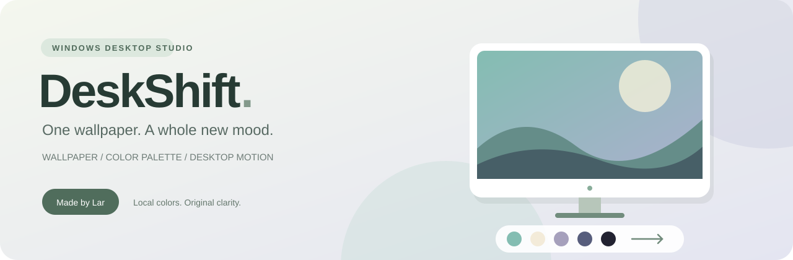
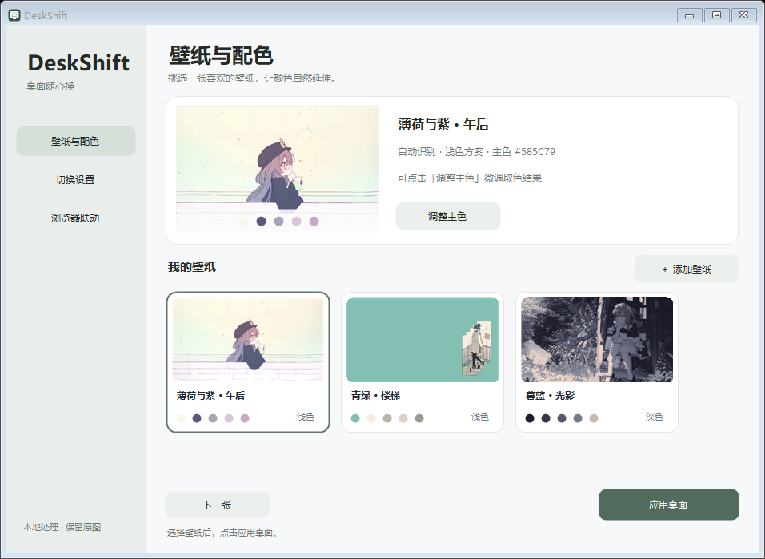
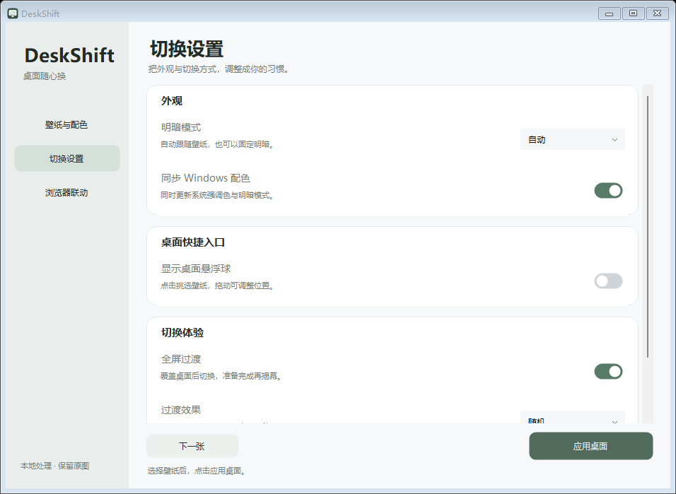
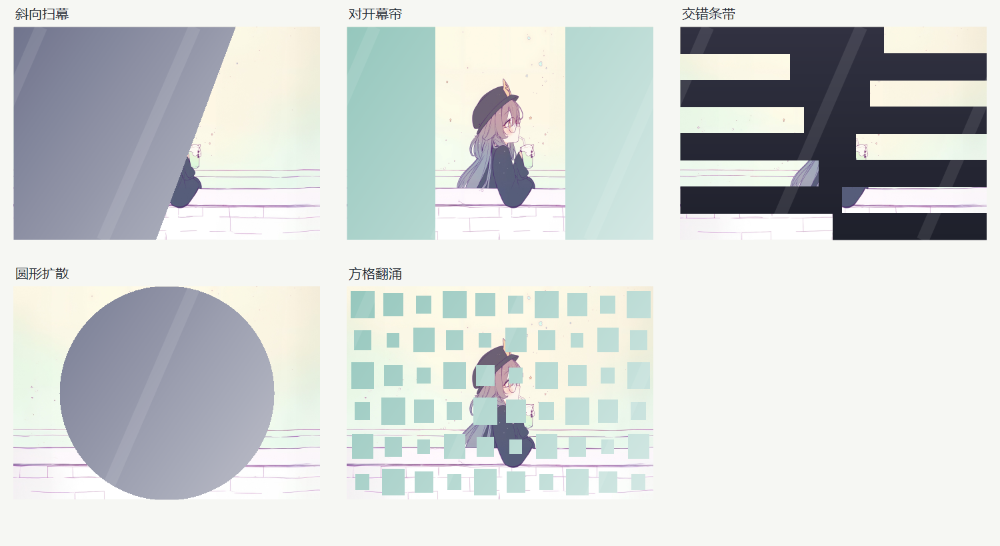
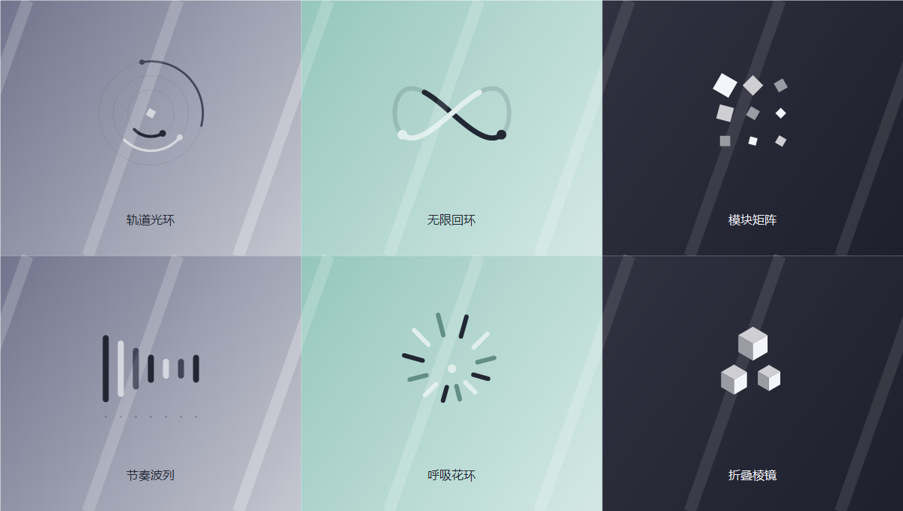
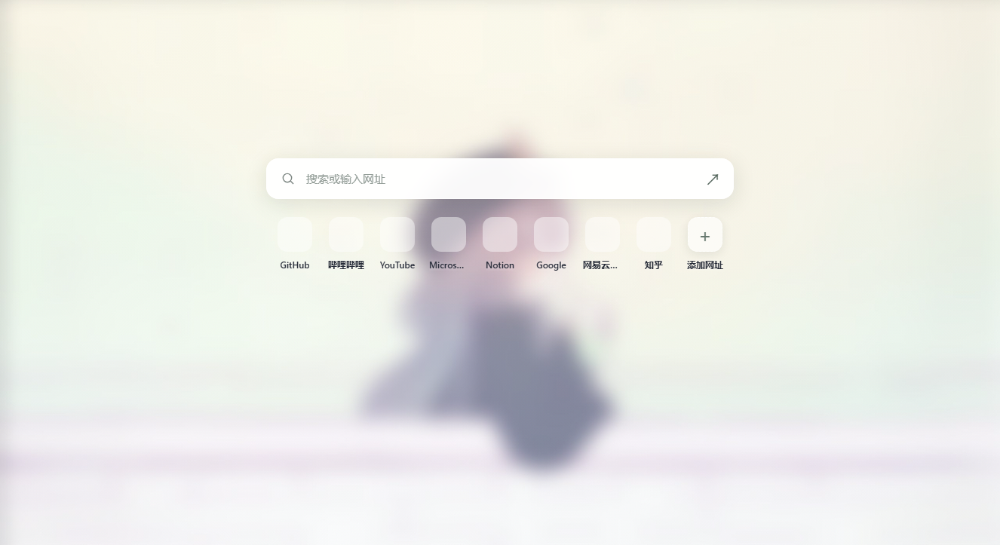

<div align="center">



### 让整个桌面，跟随一张壁纸。

[简体中文](README.md) · [English](README.en.md) · [日本語](README.ja.md)


**[快速开始](#快速开始) · [技术栈](#技术栈) · [反馈问题](https://github.com/Jax367/DeskShift/issues)**

</div>

DeskShift 是一款 Windows 桌面配色工具。从壁纸提取主色，一键更新桌面与系统配色，并导出 Chrome / Edge 浏览器主题，让浅色、薄荷绿和暮色蓝自然延伸到日常界面。

> **简洁新标签页**：可选压缩原图、亚克力模糊或抽象色块背景，搭配搜索和最常访问的网址。没有时间、日期或新闻。Chrome / Edge 新标签页自动同步，标签栏主题仍需手动加载。

[浏览器联动与背景样式的具体实现过程](docs/IMPLEMENTATION.zh-CN.md) · [最新背景样式便携包](releases/DeskShift-background-styles.zip)

网址快捷方式使用浏览器保存的原站图标，并居中排列在搜索框正下方。标题栏主题需要通过「标题栏配色指南」单独加载，不能随新标签页扩展自动更新。

## 界面一览



默认采用约 940 × 660 的紧凑窗口，侧栏分为壁纸与配色、切换设置、浏览器联动。设置使用圆角分组与开关，小屏幕会缩小窗口并提供滚动。



## 功能亮点

| 功能 | 体验 |
| :--- | :--- |
| 🎨 自动取色 | 导入 JPG、PNG、BMP，自动生成五色调色板与明暗方案；支持手动调整主色 |
| 🖥️ 一键联动 | 更新桌面壁纸、Windows 强调色和浅色 / 深色模式 |
| 🌐 简洁新标签页 | Chrome / Edge 同步原图壁纸和配色，展示最多 8 个真实常用网址 |
| ✨ 全屏过渡 | 五种覆盖与揭幕效果，随机不连重复；六种几何等待动效 |
| ⚡ 启动优化 | 隐藏窗口预热、首帧就绪后计时、窗口与资源复用、多显示器共享等待帧 |
| 🧭 托盘切换 | 右键 → 切换壁纸，直接选择图片；当前壁纸显示勾选标记 |
| 🫧 桌面悬浮球 | 可选显示；拖动并记住位置，点击展开缩略图面板，一键切换壁纸 |
| ↩️ 一步撤销 | 保存切换前的壁纸与程序修改的注册表值，跨重启保留备份 |
| 🏠 本地处理 | 取色与图片处理均在本机完成，不上传壁纸 |

<details>
<summary><b>查看过渡效果与等待动效</b></summary>

五种全屏过渡：斜向扫幕、对开幕帘、交错条带、圆形扩散、方格翻涌。



六种等待动效：轨道光环、无限回环、模块矩阵、节奏波列、呼吸花环、折叠棱镜。以下为静态预览。



</details>

## 快速开始

**环境**：Windows 10 / 11，.NET Framework 4.x。使用系统自带编译器，无需安装 .NET SDK、NuGet、Node 或 Python。

```powershell
git clone https://github.com/Jax367/DeskShift.git
cd DeskShift
powershell -ExecutionPolicy Bypass -File .\build.ps1
.\dist\DeskShift.exe
```

1. 选择内置壁纸，或通过「添加壁纸」 / 拖放导入图片。
2. 调整主色、明暗模式、系统配色与过渡设置。
3. 点击「一键应用桌面」。关闭窗口后留在托盘，右键即可切换壁纸。

当前仓库提供源码，运行文件由构建脚本生成。完整操作说明见 [中文使用指南](docs/GUIDE.zh-CN.md)。

在「切换设置 → 桌面快捷入口」打开「显示桌面悬浮球」。点击悬浮球选择壁纸，点击面板外部或按 Esc 收起；右键悬浮球可打开主窗口或隐藏。默认关闭，开关和位置会保存。

### 简洁新标签页

常用网址支持两种来源：自动读取浏览器的最常访问网站，或点击「添加网址」手动固定。手动网址优先，自动推荐补齐剩余位置；悬停卡片点「⋯」可编辑、删除或隐藏推荐。在添加窗口取消「根据访问记录自动补充网址」，即可只显示手动列表。支持恢复隐藏推荐；设置保存在当前浏览器本地，重启后保留。


在「浏览器联动」打开安装指南，在 `chrome://extensions` 或 `edge://extensions` 启用开发人员模式并加载 `browser/chrome` 或 `browser/edge`。保持新版 DeskShift 在托盘运行并应用一次壁纸，扩展会替换新标签页。原来的启动页、首页按钮地址和浏览器默认搜索引擎设置不改动。

只显示壁纸、搜索和最多 8 个最常访问网站；Chrome 搜索 Google，Edge 搜索 Bing。常用网址使用浏览器的 `topSites` 列表，同域名去重，不申请完整 `history` 权限，不上传网址；列表可能与 Edge 的置顶快捷方式不同。没有历史记录时显示提示。

在「切换设置 → 浏览器背景 → 背景样式」选择压缩原图、亚克力模糊或抽象色块。压缩原图保留画面，亚克力模糊预先柔化图片并叠加明暗遮罩与细颗粒，抽象色块只用壁纸调色板绘制大面积曲线和色块，不保留原图内容。选择后自动更新浏览器背景，不重新应用系统主题。浏览器使用独立 JPEG 副本（最长边 2560 像素、质量 82），桌面原图不变，仅缓存最近一张以供离线显示。隐藏标签页停止轮询。标签栏主题仍可导出后手动加载。开发验证：`node tests/browser-sync.js`；可选隔离排版预览：`node tests/newtab-preview.js`。



## 技术栈

| 层级 | 技术 | 用途 |
| :--- | :--- | :--- |
| 桌面应用 | C# · .NET Framework 4.x · WinForms | 壁纸库、设置、预览、托盘菜单 |
| 图像与动画 | System.Drawing · GDI+ | 像素采样、RGB 分桶取色、遮罩与几何动效 |
| Windows 联动 | Win32 P/Invoke · 注册表 · Windows `.theme` | 原尺寸壁纸、强调色、明暗模式与撤销 |
| 动画资源 | 后台任务 · 首帧屏障 · 窗口池 · LRU 缓存 | 提前准备、资源复用、跨显示器共享 |
| 浏览器扩展 | JavaScript · HTML · CSS · Manifest V3 · topSites | 简洁新标签页、常用网址与本机壁纸缓存 |
| 本机通信 | C# · TCP / HTTP · JSON | 只读壁纸和配色桥接；Host、Origin 和版本检查 |
| 构建与验证 | PowerShell · 系统 C# 编译器 · 内置自测 | 无额外包依赖构建、隐藏窗口验证 |

### 项目结构

```text
src/                    桌面应用、系统接口、动画与主题导出
browser/chrome/         Chrome 简洁新标签页与指南
browser/edge/           Edge 简洁新标签页与指南
assets/                 软件图标与三张原始壁纸
tests/                  动画性能诊断
tools/                  图标生成工具
docs/                   使用指南与展示素材
build.ps1               构建入口
```

## 验证与说明

```powershell
$p = Start-Process .\dist\DeskShift.exe -ArgumentList '--self-test' -Wait -PassThru
$p.ExitCode
Start-Process .\dist\DeskShift.exe -ArgumentList '--smoke' -Wait
```

自测和窗口预览不会修改真实桌面；输出保存在 `test-output`。真实 Windows 主题刷新和 Chrome 扩展安装需在目标环境确认。

- Windows 浅色模式不支持开始菜单与任务栏强调色，部分应用需重新打开才能刷新主题。
- 首帧预热和缓存能减少初始化开销；`DwmFlush` 只同步本程序，无法保证所有应用同时完成渲染。
- 数据位于 `%LOCALAPPDATA%\DeskShift`，程序不会自动开机启动。
- 浏览器只申请自身存储、最常访问网站和本机连接权限，程序不编辑浏览器配置；构建和运行不依赖 Node。
- README 支持三种语言；当前软件界面为简体中文。

## 参考与致谢

[Chrome 主题文档](https://developer.chrome.com/docs/extensions/develop/ui/themes) · [Windows 壁纸接口](https://learn.microsoft.com/en-us/windows/win32/api/winuser/nf-winuser-systemparametersinfow) · [DwmFlush](https://learn.microsoft.com/en-us/windows/win32/api/dwmapi/nf-dwmapi-dwmflush)

动效为项目原创几何绘制，设计参考 [MetaLab](https://dribbble.com/shots/4037784-Geometric-shapes-loading-animation)、[Infinity Loader](https://dribbble.com/shots/2465356-Infinity-Loader) 与 [IBM Design](https://www.ibm.com/design/language/animation/tips-and-techniques/)。内置壁纸由用户提供；作者署名针对本项目程序，不代表壁纸版权归属。

## 来访记录

<div align="center">
<a href="https://github.com/journey-ad/Moe-Counter">

</a>

基于 [Moe Counter](https://github.com/journey-ad/Moe-Counter)，使用 [Lolihouse 托管服务](https://moecount.lolihouse.top/)。图片请求计数会受 GitHub 图片缓存影响，不代表独立访客数。

**Lar** · [turelar367@gmail.com](mailto:turelar367@gmail.com)

</div>

版本备份与下载：[稳定版和试验版](docs/BACKUP-VERSIONS.md)。
