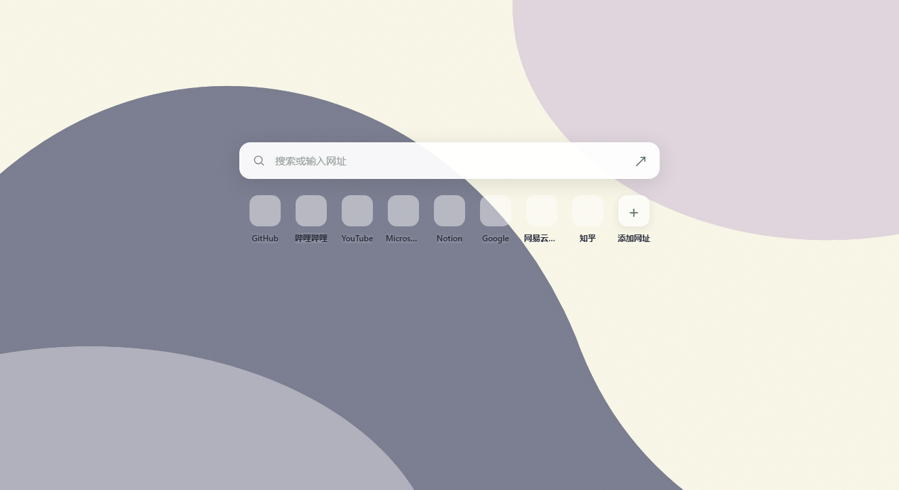
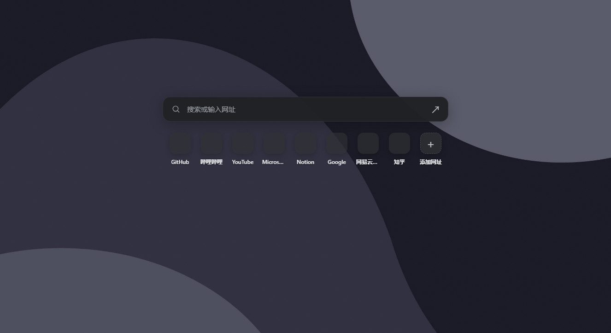

# 浏览器联动与背景样式：实现过程

[返回首页](../README.md) · [自动主题加载说明](AUTO-THEME.zh-CN.md) · [历史备份](BACKUP-VERSIONS.md)

本次发布包含 Chrome / Edge 双浏览器选择、三种浏览器背景以及覆盖期间的试验性标题栏主题加载流程。桌面原图保持原始分辨率，浏览器背景独立生成。没有在本次发布中新增强制获取焦点、恢复最小化窗口或自动重启浏览器的实现。

## 1. 壁纸与配色准备

导入壁纸时，`src/Core.cs` 提取主色、调色板与明暗模式。应用时，`src/App.cs` 在后台准备原尺寸桌面缓存、Windows 主题和全屏过渡资源，准备完再开始覆盖。

浏览器标题栏与新标签页分别处理：标题栏使用只包含颜色的主题；新标签页扩展负责背景、搜索框与常用网址。重新加载新标签页扩展不等于重新加载标题栏主题。

## 2. 生成浏览器标题栏主题

`Library.ExportBrowser` 分别更新 `%LOCALAPPDATA%\DeskShift\browser-themes\chrome\current` 和 `edge\current` 中的 `manifest.json` 与手动指南。

主题包含 frame、toolbar、标签文字和地址栏等颜色，不包含壁纸、页面覆盖、脚本或运行时权限。颜色发生变化时清除该导出目录的旧主题缓存。浏览器不会因为磁盘文件被更新而立即重新读取主题。

## 3. 覆盖期间尝试自动加载

设置页提供自动加载总开关和 Edge、Chrome 独立开关，可同时选择。旧版单浏览器选择在升级时保留。自动加载默认关闭。

实际执行顺序如下：

1. 全屏过渡完全覆盖桌面，确认未取消。
2. 将导出的纯配色主题按内容摘要复制到独立目录，避免不同配色共用缓存；加载前验证颜色字段及 RGB 范围。
3. 按 Edge、Chrome 顺序寻找浏览器窗口；每种浏览器只接受一个可见窗口，并核对可执行文件位置。
4. 尝试取得浏览器焦点，打开临时标签页，进入内部 `version` 页面确认使用 Default 配置。
5. 进入内部 `extensions` 页面，通过 Windows UI Automation 找到「加载已解压的扩展程序」。开发者模式必须事先由用户开启。
6. 确认文件夹选择框属于目标浏览器，填写主题目录并调用「选择文件夹」。
7. 只读检查浏览器 Preferences 的主题目录记录；登记匹配后关闭自己的临时标签页，并尝试恢复原焦点。登记成功不等于已确认顶部颜色呈现。
8. 应用 Windows 主题与桌面壁纸，发布新标签页背景，等待切换稳定后揭开覆盖。

单浏览器限时 6.5 秒；双浏览器共享约 9 秒预算；全屏过渡有 12 秒保护。检测到用户输入、焦点变化、未知控件、取消或超时则停止。如果前一个浏览器留下临时页面或文件选择框，将停止后续浏览器，避免误操作。设置页保存最近结果。

这一路径不开放远程调试端口、不直接改写浏览器 Preferences、不使用剪贴板或全局输入监听，也不会强制结束浏览器。

## 4. 三种背景样式

在「切换设置 → 浏览器背景」选择样式；选项存入本地设置。更改样式只更新新标签页背景，不再次应用 Windows 主题或执行标题栏加载。

| 样式 | 实现 | 画面内容 |
| --- | --- | --- |
| 压缩原图 | 按比例生成最长边不超过 2560 像素、质量 82 的 JPEG | 保留原图构图 |
| 亚克力模糊 | 在小尺寸副本上执行三轮分离式盒式模糊，再生成浏览器 JPEG；页面叠加明暗遮罩和细颗粒 | 柔化细节、保留整体色调 |
| 抽象色块 | 仅根据调色板绘制大面积 Bézier 曲线和椭圆 | 不保留原图人物、建筑或轮廓 |

生成代码位于 `src/BrowserWallpaper.cs`。缓存按源文件、样式和必要的配色信息区分。`src/Bridge.cs` 在后台生成并使用版本标记阻止旧任务覆盖新请求；生成失败时保留原有发布内容。图片只通过本机只读服务提供，原始桌面图片不被覆盖或缩小。

上述页面预览使用隔离测试中的示例网址；不包含用户浏览记录。

## 5. 新标签页同步

Chrome 和 Edge 扩展读取本机 `127.0.0.1:47831` 的主题与背景，按明暗模式调整搜索框和快捷链接底色，并按 `backgroundStyle` 选择遮罩效果。只缓存最近背景以供离线显示；隐藏标签页暂停轮询。

常用网址使用浏览器 `topSites` 提供的列表，手动添加优先显示。网站图标通过浏览器自身的 favicon 接口读取，不生成字母或品牌图标，也不把网址发送给外部图标服务。历史列表和手动网址保留在浏览器扩展本地存储。

## 6. 验证与实际限制

- 软件自检验证设置持久化、旧设置迁移、双浏览器顺序、纯配色主题验证、缓存、原图分辨率及像素保持。
- 抽象色块测试：两张内容不同但尺寸相同的图片，使用相同调色板时生成相同背景，确认输出不依赖原图内容。
- `tests/browser-sync.js` 覆盖 Chrome / Edge 的在线、离线同步、网址管理、favicon 与三种样式。
- `tests/newtab-preview.js` 生成三种样式的浅色和深色隔离预览，检查实际页面配色与布局。
- 用户已确认 Edge 适配良好，并观察到关闭所有窗口再打开后标题栏颜色生效；这不能单独证明覆盖期间自动加载成功。
- 用户已确认 Chrome 手动加载主题有效。先前独立自动化测试停在焦点获取；最近的桌面检查发现 Chrome 最小化，后续操作因控制工具无法可靠确认浏览器网址而停止，未完成自动加载验证。

因此，Chrome 自动加载仍保留「试验」标记。本次提交没有把建议中的焦点修复写成已经完成，也不把普通软件自检当作真实浏览器自动安装成功的证据。

## 7. 使用与回退

运行便携包中的 `DeskShift.exe`，按照浏览器联动页安装或重新加载相应的新标签页扩展。尝试标题栏自动加载时，需要全屏过渡、Default 配置、单窗口以及事先启用的开发者模式。失败时查看切换设置里的结果，也可以使用标题栏配色指南手动加载。

关闭自动加载总开关即可停止该流程。此前稳定版与试验版的 GitHub 备份保留在 [历史备份](BACKUP-VERSIONS.md)。最近一次修改前的源码和可运行版本另存于本机 `backups/before-chrome-auto-20261011-144608/`，该目录、个人设置、测试数据与密钥不上传仓库。
